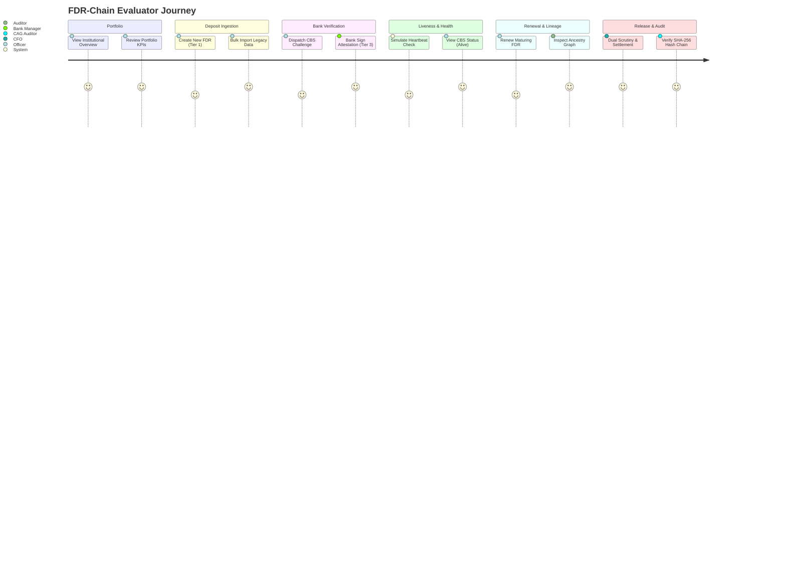

# FDR-Chain: Complete Demonstration & Evaluator Walkthrough

## 1. Overview & Demonstration Goals

This guide provides an end-to-end operational walkthrough for evaluators, reviewers, and stakeholders. It showcases the full capabilities of **FDR-Chain** across all 9 architectural phases, highlighting:

- Institutional Multi-Tenancy & Data Isolation
- 3 Orthogonal Properties (Lifecycle, Trust Tier, Heartbeat)
- Bank Core Banking Solution (CBS) API Verification & Ed25519 Signatures
- Automated Heartbeat Monitoring & Liveness Audits
- FDR Lineage Tree (DAG) & Lifecycle Traversal
- Legacy Bulk Migration (CSV/Excel) & Field Mapping
- Multi-Tier Release Scrutiny, Dual Approval & Settlement
- Immutable RFC 8785 SHA-256 Hash-Chain Audit Verification

---

## 2. Step-by-Step Evaluator Script

---

### Step 1: Institutional Portfolio & Analytics
1. Open the portal at [http://localhost:5173](http://localhost:5173).
2. Ensure you are acting as **Rajesh Sharma (`officer.nhai@fdrchain.gov.in`)**.
3. Observe the **Dashboard Overview**:
   - Total Portfolio Value (e.g. ₹425.50 Cr)
   - Trust Tier Breakdown (Tier 1 Declared vs Tier 2 API Verified vs Tier 3 Signed)
   - Heartbeat Health Indicators (Alive vs Stale vs Broken)
   - Upcoming Maturity Reminders (within 30/60/90 days)

---

### Step 2: Creating an FDR & Ingesting Legacy Data
#### A. Manual Creation
1. Navigate to **FDR Management** > **New Deposit**.
2. Enter deposit details:
   - **Bank**: State Bank of India
   - **Branch**: SBI Main Branch (IFSC: `SBIN0000691`)
   - **FDR Number**: `FDR-2026-DEMO-001`
   - **Amount**: ₹5,00,00,000 (Five Crores)
   - **Issue Date**: Today's Date
   - **Maturity Date**: 1 Year from Today
   - **Interest Rate**: 7.25%
   - **Lien in Favour**: Chairman, NHAI
3. Click **Submit Deposit**.
4. Observe the newly created FDR:
   - **Lifecycle Status**: `Pending`
   - **Trust Tier**: `Tier 1 (Institution Declared)`
   - **Heartbeat Status**: `Not Started`

#### B. Legacy Excel/CSV Bulk Migration
1. Navigate to **Data Migration** > **New Import Batch**.
2. Upload a sample legacy spreadsheet (`.xlsx` or `.csv`).
3. Use the **Interactive Column Mapper** to link legacy headers (`Receipt_No`, `FD_Amt`, `Bank_Code`) to canonical FDR fields.
4. Review rows in the **Staging Grid**, correct any highlighted warnings in the review modal, and click **Execute Import**.
5. Verified: Imported rows enter as `Trust Tier 1` with initial audit entries.

---

### Step 3: Bank CBS Verification & Ed25519 Cryptographic Signatures
1. Open the details page for `FDR-2026-DEMO-001`.
2. Click **"Request CBS Verification"**.
   - A single-use verification challenge token is dispatched to SBI.
3. Switch persona to **Amitabh Sen (`bank.sbi@fdrchain.gov.in`)**.
4. In the **Bank Portal**, locate the pending verification request.
5. Click **"Verify & Sign Attestation"**:
   - The bank signs the canonical deposit payload using its registered **Ed25519 private key**.
   - The digital attestation is stored immutably with cryptographic proof.
6. Switch back to **Rajesh Sharma**.
7. Refresh the FDR details:
   - **Trust Tier** has elevated to **`Tier 3 (Signed Attestation)`** with a green cryptographic badge.
   - **Lifecycle** remains `Pending` and **Heartbeat** remains `Not Started` (proving independence of properties).

---

### Step 4: Heartbeat Monitoring & CBS Liveness Probing
1. In the FDR details page, click **"Trigger Liveness Probe"**.
2. The heartbeat engine dispatches an automated balance/lien check to the CBS mock adapter.
3. Observe the response latency (e.g. `142ms`) and status transition:
   - **Heartbeat Status**: Changes to **`Alive`** with a green pulse indicator.
   - The last verified balance matches the current principal.

---

### Step 5: FDR Rollover, Renewal & Lineage DAG Graph
1. On a mature FDR, click **"Initiate Renewal"**.
2. Choose renewal terms (e.g., rollover principal + accrued interest ₹5,36,25,000 for 12 months at 7.4%).
3. Submit the renewal order.
4. Navigate to the **FDR Lineage Explorer**:
   - Inspect the interactive DAG graph.
   - Hover over nodes to trace the full historical lineage from the initial deposit through multiple renewal rollovers.

---

### Step 6: Officer Task Queue & Priority Triage
1. Navigate to **Officer Tasks**.
2. View the unified institutional task queue sorted by dynamic priority score:
   - High priority flags on maturing deposits, broken heartbeats, and pending scrutiny requests.
3. Assign a task, leave an internal audit comment, or escalate to senior leadership.

---

### Step 7: Dual-Control Scrutiny & Settlement Closure
1. Navigate to **Release & Closure** > **New Release Request**.
2. Select an active FDR whose contractual term has concluded.
3. Complete the multi-point scrutiny checklist:
   - [x] Concessionaire completion certificate verified
   - [x] No pending encumbrances or court orders
   - [x] Formal lien discharge letter attached
4. Submit the request for CFO approval.
5. Switch persona to **Priya Sundaram (`admin.nhai@fdrchain.gov.in`)**.
6. Review the scrutiny packet, sign the approval mandate, and dispatch instructions to the bank.
7. Click **"Confirm CBS Settlement"**:
   - **Lifecycle Status** updates to **`Closed`**.
   - Trust Tier and past heartbeat telemetry remain immutably preserved for audit.

---

### Step 8: SHA-256 Audit Chain Verification
1. Switch persona to **Vikramaditya Rao (`auditor.cag@fdrchain.gov.in`)**.
2. Open `FDR-2026-DEMO-001` and navigate to the **Cryptographic Audit Chain** tab.
3. Click **"Verify Entire Audit Chain"**.
4. Observe the validation engine verifying each block:
   - Genesis Block (`prev_event_hash: 000000000...`)
   - Creation Event
   - Document Upload Event
   - Tier 2 Challenge Event
   - Tier 3 Signature Event
   - Liveness Probe Event
   - Release & Closure Event
5. The screen displays: **"Audit Chain Fully Intact – All 7 Event Hashes Verified Cryptographically"**.
