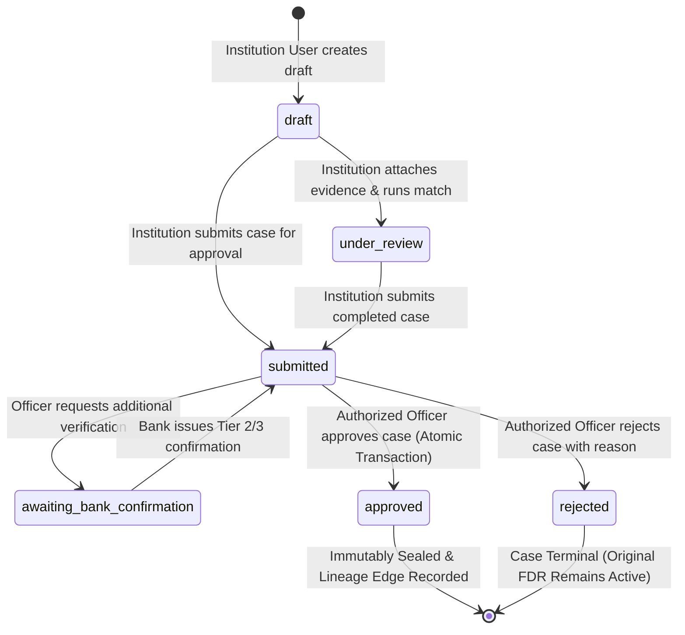

# FDR Monitoring System - Phase 5 Architecture Documentation

## Renewal Management & FDR Lineage Architecture

### 1. Executive Summary
Phase 5 introduces comprehensive **Renewal Case Management** and **FDR Lineage Tracking** to the AICTE Fixed Deposit Receipt (FDR) Monitoring Platform. 

In institutional compliance frameworks, fixed deposits submitted as security or reserve funds frequently mature and are replaced by rollover deposits, converted deposits, or replacement certificates. Before Phase 5, these renewed deposits were registered as disconnected records, causing audit fragmentation, double-counting risk, and difficulty tracing fund continuity.

Phase 5 addresses these operational challenges through:
1. **Governed Renewal Cases**: A structured, multi-role state machine transitioning cases from Draft $\to$ Under Review $\to$ Submitted $\to$ Approved / Rejected.
2. **Deterministic 6-Signal Matching Engine**: An advisory heuristic scoring algorithm ranking potential replacement candidate FDRs without automated execution.
3. **Cryptographically and Attestation-Verified Replacement Checks**: Enforcing that replacement FDRs independently attain Trust Tier $\ge 2$ or official bank confirmation prior to approval.
4. **Strict Directed Acyclic Graph (DAG) Lineage**: A multi-generation provenance chain with cycle detection, predecessor conflict checks, and ancestor/descendant graph traversal.
5. **Auditable Transition Transactions**: Atomic transitions that simultaneously approve cases, register lineage edges, transition original FDRs to `renewed`, and preserve immutable snapshots.

---

### 2. Core Entities & System Topology

```
+-----------------------------------------------------------------------------------+
|                               RENEWAL SUBSYSTEM                                   |
+-----------------------------------------------------------------------------------+
                                        |
       +--------------------------------+-------------------------------+
       |                                                                |
       v                                                                v
+-----------------------------+                           +-----------------------------+
|    Original FDR (Parent)    |                           |  Replacement FDR (Child)    |
|   Status: active -> renewed |                           |       Status: active        |
|  Trust Tier: Preserved      |                           |    Trust Tier: >= 2 req.    |
+-----------------------------+                           +-----------------------------+
               \                                                         /
                \_________________   Renewal Case   ____________________/
                                  \  (State Machine) /
                                   v                v
                       +---------------------------------------+
                       |             Renewal Case              |
                       |  - ID, Case Number, Institution ID    |
                       |  - Original FDR ID, Replacement ID    |
                       |  - Status (draft -> approved)         |
                       |  - Matching Score & Advisory Signals  |
                       |  - Officer Review Notes & Timestamps  |
                       +---------------------------------------+
                                      |            |
                     +----------------+            +----------------+
                     |                                              |
                     v                                              v
      +-----------------------------+                +-----------------------------+
      |       Renewal Evidence      |                |         FDR Lineage         |
      | - Document Type             |                | - Parent FDR ID             |
      | - Document URL / Hash       |                | - Child FDR ID (UNIQUE)     |
      | - Verification Status       |                | - Relationship Type         |
      | - Uploaded Timestamp        |                | - Renewal Case Reference    |
      +-----------------------------+                | - Approval Timestamp        |
                                                     +-----------------------------+
```

---

### 3. Renewal Case State Machine

The renewal lifecycle strictly adheres to the state transitions defined below:



#### State Transition Invariants:
1. **Immutability of Terminal States**: Once a case reaches `approved` or `rejected`, no further edits, modifications, or state transitions are permitted.
2. **Submission Validation**: A case cannot be transitioned to `submitted` unless both `original_fdr_id` and `replacement_fdr_id` are populated, belonging to the same institution.
3. **Atomic Approval Pre-Conditions**:
   - Approver must hold an authorized role (`regional_officer`, `regulation_officer`, `admin`).
   - Replacement FDR must independently possess Trust Tier $\ge 2$ or verified bank confirmation.
   - At least one verified or active renewal evidence document must be attached.
   - Cycle check must confirm adding `(original_fdr_id -> replacement_fdr_id)` will not form a cycle.
   - Predecessor check must confirm `replacement_fdr_id` is not already the child in another lineage record.

---

### 4. Role-Based Governance Matrix

| Role | Create Draft | Edit Draft | Submit Case | Run Matching | Upload Evidence | Review Queue | Approve / Reject |
| :--- | :---: | :---: | :---: | :---: | :---: | :---: | :---: |
| **Institution User** | Yes (Own) | Yes (Own) | Yes (Own) | Yes (Own) | Yes (Own) | No | No |
| **Bank Nodal Officer** | No | No | No | No | No | Yes (Bank FDRs) | No (Can Confirm) |
| **Regional Officer** | No | No | No | Yes (View) | Yes (Add) | Yes (Region) | Yes (Region) |
| **Regulation Bureau** | No | No | No | Yes (View) | Yes (Add) | Yes (All) | Yes (All) |
| **Finance Officer** | No | No | No | Yes (View) | No | Yes (Read Only)| No |
| **System Administrator**| Yes | Yes | Yes | Yes | Yes | Yes (All) | Yes (Audit Logged) |

---

### 5. Independent Trust Tier & Bank Verification Requirement

A critical design principle of Phase 5 is **verification independence**:
- Under no circumstances does a replacement FDR inherit trust status, digital signatures, or verification records from the predecessor FDR.
- A replacement FDR represents a distinct legal commitment from the banking institution.
- To prevent fictitious or forged rollovers, the approval service mandates that `replacement_fdr.trust_tier >= 2` or `replacement_fdr.bank_confirmed == True` before approval is committed.

---

### 6. Lineage Graph & DAG Integrity

The lineage engine maintains FDR provenance as a Directed Acyclic Graph (DAG):
1. **Predecessor Exclusivity**: Each replacement FDR may have at most one predecessor (`child_fdr_id UNIQUE` constraint).
2. **Cycle Prevention**: Prior to committing any edge `Parent -> Child`, the system executes a recursive graph traversal from `Child` searching for `Parent`. If `Parent` is reachable from `Child`, the transaction aborts with a 400 Bad Request error.
3. **Multi-Generation Traversal**: Recursive queries retrieve full ancestral roots (original starting deposit) and full descendant leaves (current active deposit).
4. **Audit Trail**: Every edge immutably stores the `renewal_case_id`, `created_by`, `relationship_type`, and `metadata` (such as amount differential and interest rate adjustments).
