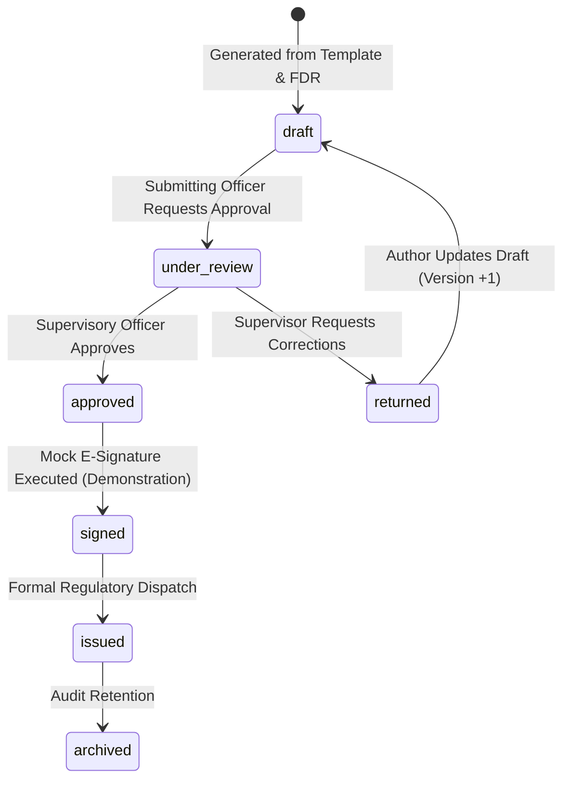

# Phase 7: Compliance Document Management & Supervisory Review Workflow

## 1. Executive Summary & Purpose
The Compliance Document Management subsystem provides an automated, auditable, and statutory document generation framework for AICTE regulatory oversight.

The system manages the end-to-end lifecycle of legal and compliance instruments, including:
- Pre-filled draft generation using AICTE approved statutory templates
- FDR state interpolation (institution details, FDR principal amount, branch manager details, maturity dates)
- Granular document versioning with immutable SHA-256 cryptographic snapshotting
- Supervisory review workflows (drafting, submission, approval, return for correction)
- ReportLab-powered PDF rendering with official AICTE typography and headers
- Mock e-signing with a strictly enforced demonstration banner and disclaimer

---

## 2. Statutory Templates Catalog

The platform seeds 6 pre-configured statutory templates matching AICTE regulatory mandates:

| Template Code | Template Title | Applicable Stage | Category |
| :--- | :--- | :--- | :--- |
| `TMPL-DEFICIT-001` | Notice of Fixed Deposit Receipt Deficit | Heartbeat Failure / Discrepancy | Non-Compliance Notice |
| `TMPL-SHOWCAUSE-002` | Show Cause Notice for Unverified FDR Corpus | Stale / Broken Heartbeat | Statutory Show Cause |
| `TMPL-NOC-RELEASE-003` | Provisional No Objection Certificate for FDR Closure | Pre-Release Review | Institutional NOC |
| `TMPL-CONF-VERIF-004` | Certificate of Verified FDR Compliance | Trust Tier 2 / 3 Certified | Statutory Confirmation |
| `TMPL-BANK-CONFIRM-005` | Statutory Bank Branch Confirmation Request | Third-Party Bank Inquiry | Banking Communication |
| `TMPL-REG-WARNING-006` | Regulatory Warning Letter: Discrepancy Flag | Lien Revocation / Maturity Breach | Regulatory Warning |

Each template features parameterized token variables: `{{fdr_number}}`, `{{institution_name}}`, `{{principal_amount}}`, `{{bank_name}}`, `{{branch_name}}`, `{{maturity_date}}`, `{{officer_name}}`, and `{{current_date}}`.

---

## 3. Supervisory Review & Approval State Machine

Documents adhere to a 6-stage lifecycle state machine:


### 3.1 Immutable Version Snapshots
Whenever an officer modifies the content of a document draft, the platform creates a new entry in `compliance_document_versions`:
- Generates an incremental version counter (`v1`, `v2`, `v3`).
- Computes an SHA-256 hash of the modified content string: `content_hash = hashlib.sha256(content.encode('utf-8')).hexdigest()`.
- Captures the modifying user ID, timestamp, and optional changelog summary.
- The latest version content is automatically reflected in the parent `compliance_documents` record.

---

## 4. PDF Generation & Layout Specifications

Compliance documents are rendered as print-ready, high-resolution PDFs using Python `reportlab` with standard government styling:
- **Header Banner**: Deep Navy `#12345A` header block featuring:
  - `"ALL INDIA COUNCIL FOR TECHNICAL EDUCATION"` (Primary Heading, 14pt Bold, White)
  - `"(A Statutory Body of the Government of India)"` (Subheading, 9pt, Light Gray)
  - `"Nelson Mandela Marg, Vasant Kunj, New Delhi - 110070"` (Contact, 8pt, Light Gray)
- **Document Metadata Strip**: Reference number, generation date, associated FDR ID, and statutory template code.
- **Body Content**: Justified 10pt typography with structured paragraph indents.
- **Dynamic Signature Block**: Designated signatory credentials, designation, and verification timestamp.

---

## 5. Strict Mock E-Signing Invariant

In strict compliance with Phase 7 boundary rules:
> **Real PKI/DSC token integration is OUT OF SCOPE. Mock e-signing is a visual simulation and demonstration only.**

### 5.1 Mandatory Disclaimers
1. **Database & API Records**: Any mock signature created via `/api/v1/compliance/documents/{id}/sign` records:
   - `is_mock = True`
   - `algorithm = "SIMULATED-DEMO-ONLY"`
   - `disclaimer = "DEMO — NOT A LEGALLY VALID DIGITAL SIGNATURE"`
2. **Visual UI Watermark**: The signature preview banner and PDF footer render a high-visibility amber warning box:
   ```
   ⚠️ DEMO — NOT A LEGALLY VALID DIGITAL SIGNATURE
   This digital signature demonstration represents a simulated regulatory endorsement for workflow prototyping only.
   ```
3. **No External Credentials**: The user enters their full name and designation to simulate an approval signature. No actual cryptographic keys, Aadhaar e-Sign, or USB token PINs are accepted or simulated.
