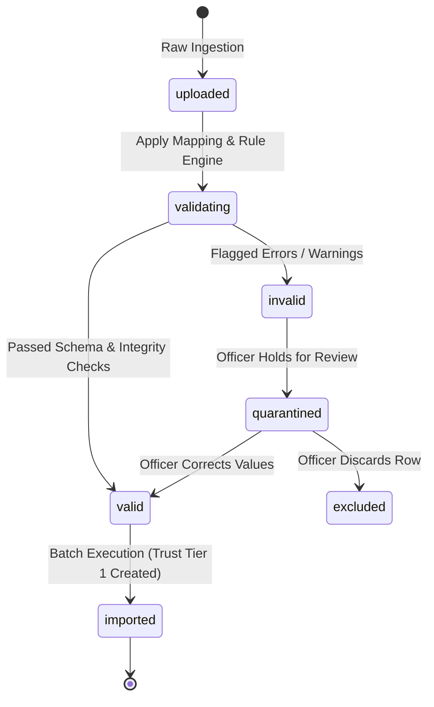

# Phase 7: Legacy Data Migration Architecture & Technical Specification

## 1. Executive Summary & Purpose
The AICTE FDR-Chain Legacy Data Migration subsystem provides an enterprise-grade ingestion pipeline for onboarding historical, paper-based, and pre-existing bank Fixed Deposit Receipts into the digital FDR-Chain platform.

Before this subsystem, thousands of legacy FDRs existed only as scanned records, physical safe files, or heterogeneous bank branch spreadsheets. The legacy migration desk enables authorized regulatory officers to upload batch spreadsheets (`.xlsx` or `.csv`), heuristically map heterogeneous headers to canonical AICTE FDR schema definitions, perform comprehensive field-level validation and fuzzy duplicate detection, review and quarantine erroneous rows, and idempotently commit validated records into the central database.

---

## 2. Strict Legacy Invariants

### 2.1 The Trust Tier 1 Invariant (CRITICAL)
In strict accordance with AICTE FDR security principles:
> **EVERY FDR created through the legacy migration pipeline MUST initialize at Trust Tier 1 (`trust_tier = 1`).**

- Under NO circumstances can legacy migration generate a Tier 2, Tier 3, or Tier 4 verified record.
- Every imported record is assigned:
  - `trust_tier`: `1`
  - `verification_status`: `'institution_declared'`
  - `lifecycle_status`: `'pending'`
  - `heartbeat_status`: `'not_started'`
- The record must subsequently undergo Phase 3 digital verification (Bank verification token / cryptographically verified certificate) to advance to higher trust tiers.

### 2.2 Secure Spreadsheet Parsing
- **Zero Formula Execution**: Macro and dynamic formula execution are explicitly disabled in spreadsheet parsing (`openpyxl.load_workbook(data_only=True)`) to eliminate formula injection (CSV/Excel Formula Injection, CWE-1236).
- **Strict Content Type Validation**: Only MIME types `text/csv`, `application/vnd.ms-excel`, and `application/vnd.openxmlformats-officedocument.spreadsheetml.sheet` with corresponding extensions `.csv` and `.xlsx` are processed. Maximum batch upload size is capped at 15 MB / 10,000 rows.

### 2.3 Strict Row Review Quarantine & Idempotency
- Erroneous rows (e.g. negative amounts, malformed dates, missing mandatory fields) are isolated into a `quarantined` state.
- Officers can review, correct, or exclude flagged rows in a dedicated review modal before committing.
- Import execution is completely idempotent: re-triggering import on an already imported batch safely returns the existing import count without duplicating FDR records.

---

## 3. Spreadsheet Ingestion & Column Mapping Engine

### 3.1 Supported Canonical Fields
The engine maps incoming columns to the canonical target schema:
| Target Field | Type | Mandatory | Description / Heuristics |
| :--- | :--- | :--- | :--- |
| `fdr_number` | String | Yes | Fixed Deposit Receipt number or certificate ID |
| `institution_id` / `institution_code` | UUID/String | Yes | AICTE Institution Permanent ID (resolved against `institutions` table) |
| `bank_name` | String | Yes | Banking organization name |
| `branch_name` | String | No | Branch locality or commercial branch name |
| `ifsc_code` | String | No | 11-character RBI IFSC code |
| `account_number` | String | Yes | Underlying FD/Deposit account number |
| `principal_amount` | Decimal | Yes | Principal deposit amount (> 0 INR) |
| `interest_rate` | Decimal | Yes | Annual interest rate (0% - 25%) |
| `deposit_date` | Date | Yes | Start / Issue date (ISO-8601 or DD/MM/YYYY) |
| `maturity_date` | Date | Yes | End / Maturity date (must be > deposit_date) |
| `joint_holder_aicte` | Boolean | No | Indicates joint holding with Member Secretary, AICTE |
| `auto_renewal` | Boolean | No | Auto-renewal instruction status |
| `remarks` | String | No | Additional migration or institutional context |

### 3.2 Heuristic Auto-Mapping Algorithm
The `MigrationService.suggest_column_mappings` engine uses regex pattern matching and token similarity across canonical synonyms:
- `fdr_number`: `['fdr', 'fdr_no', 'fdr_number', 'receipt_no', 'certificate_no', 'deposit_no']`
- `principal_amount`: `['amount', 'principal', 'deposit_amount', 'fdr_amount', 'sum']`
- `maturity_date`: `['maturity', 'maturity_date', 'due_date', 'expiry_date', 'end_date']`
- `institution_code`: `['institution_code', 'aicte_id', 'permanent_id', 'inst_code']`

Officers can save verified mapping configurations as reusable `migration_mapping_profiles` for specific banks or state directorates.

---

## 4. Validation Engine & Row Lifecycle

Each uploaded row transitions through the following lifecycle states:

### 4.1 Validation Rule Matrix
1. **Principal Amount**: Must be positive decimal (> 0). Negative amounts or non-numeric tokens are rejected.
2. **Interest Rate**: Must be between 0.0% and 25.0%.
3. **Date Integrity**: `deposit_date` and `maturity_date` must parse into valid ISO calendar dates, and `maturity_date >= deposit_date`.
4. **Fuzzy Duplicate Detection**: Detects collisions against both the existing central FDR registry and previously uploaded rows in the batch using stringified fuzzy matching on `fdr_number`, `bank_name`, and `account_number`.

---

## 5. Database Schema & Tables
Migration tables added in `database/19_phase7_schema.sql`:
1. `migration_batches`: Tracks batch metadata, file hash (SHA-256), stage, status, total rows, valid/invalid counts, and user attribution.
2. `migration_batch_rows`: Stores raw payload JSONB, parsed values JSONB, validation status, error/warning arrays, and corrected values JSONB.
3. `migration_mapping_profiles`: Reusable column mapping profiles with bank associations and system-wide default flags.
